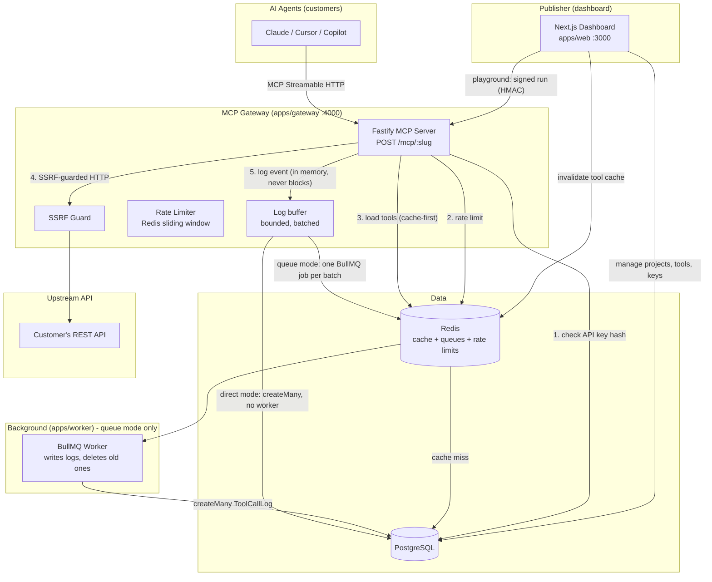

# Architecture

> Last updated: Phase 5a — the Playground, the Connect guides and the signed internal route

## System Overview

MCP Gateway is a multi-tenant SaaS platform. A **publisher** (an API team) creates a project, imports their OpenAPI spec, curates a set of MCP tools, and gets a hosted MCP endpoint their customers' AI agents can call.



## Packages

| Package | Purpose |
|---|---|
| `apps/web` | Next.js App Router dashboard — UI + server actions + route handlers |
| `apps/gateway` | Fastify MCP server — public, multi-tenant, stateless |
| `apps/worker` | BullMQ consumer (queue mode) — writes call-log batches to Postgres and deletes rows past retention |
| `packages/db` | Prisma schema, client singleton (driver adapter), migrations, log writing and retention. Two subpaths: `@mcp-gateway/db/seed` (the analytics seed, kept out of the main entry so the gateway does not load it) and `@mcp-gateway/db/test-database` (one test database per suite) |
| `packages/shared` | SSRF-safe fetch, env validation, Redis cache key names and invalidation helpers, argument masking, the Playground request signature (`playground-signature.ts`) and the upstream timeout defaults (`timeouts.ts`) |
| `packages/openapi-tools` | Pure library: OpenAPI → tool definitions, argument-to-request mapping, request building, re-import merging |
| `packages/crypto` | AES-256-GCM encrypt/decrypt + API key generation/hashing |

## Key Design Decisions

See [DECISIONS.md](./DECISIONS.md) for the full log.

- **The gateway is read-mostly** — it reads from Redis cache (fallback to Postgres). Its writes are `ApiKey.lastUsedAt` (at most once per key per 5 minutes) and, in direct mode, call-log batches; both are off the request path, so the request path stays decoupled from write latency.
- **API keys stored as SHA-256 hashes** — full key shown once, never stored. Prefix stored for UI display.
- **Upstream credentials encrypted at rest** — AES-256-GCM, key from `ENCRYPTION_KEY` env var.
- **SSRF protection** — block private/loopback IP ranges before calling any user-supplied upstream URL.
- **Driver adapter pattern** — `@prisma/adapter-pg` + `pg` for explicit connection pool control and compatibility with edge runtimes.

## Request path: a `tools/call`

`POST /mcp/:projectSlug` on the gateway. It is stateless: a fresh MCP server object per request, no sessions.

1. **Authenticate.** `Authorization: Bearer <key>` is parsed, SHA-256 hashed and looked up (Redis, then Postgres). The key must belong to the project in the URL. Every failure (missing, malformed, unknown, revoked, another project's key, unknown slug) gives the same 401, so slugs cannot be enumerated.
2. **Load the project.** The base URL, the encrypted credential and the enabled tools (with their argument-to-request maps) come from `mcp:cfg:<slug>` in Redis, or are built from Postgres and cached.
3. **Rate limit.** A `tools/call` counts against the key's limit (`ApiKey.rateLimitPerMin`, calls per rolling 60 s); over it, the answer is HTTP 429 with `Retry-After` before anything else runs. Other methods (`initialize`, `tools/list`) are free. See below.
4. **Resolve the tool.** Only enabled, non-removed tools exist. Anything else is the same `-32602` "Unknown tool".
5. **Validate** the arguments against the tool's agent-facing schema (hidden parameters removed). A failure is an `isError` result the model can read and correct.
6. **Build the request.** Hidden parameters' fixed values are merged last, so they always win; a hidden parameter fixed to `null` means "never send it" and is left out (`hiddenArguments` in `apps/gateway/src/mcp/call-tool.ts`). Arguments are mapped to path, query, header, cookie or body.
7. **Authenticate to the upstream.** The credential is decrypted in memory for this one call and sent as a bearer token, a custom header, or a query parameter.
8. **Call the upstream** through `ssrfFetch`: public addresses only, no redirects, one 15 s deadline, a 1 MB response cap.
9. **Answer.** A 2xx becomes text content. Everything else (4xx/5xx, timeout, oversize, redirect, blocked host, unreachable) becomes an `isError` result with fixed wording. The credential is scrubbed from every outgoing string, in raw, URL-encoded and base64 form.

Each tool call also produces a log event (see Call logging), including calls that failed validation, named an unknown tool or were rate limited.

### Rate limiting

One Redis sorted set per key (`mcp:rl:<apiKeyId>`) holds a member per accepted call, scored by its time. One Lua script trims, counts and either rejects (returning the exact wait) or records the call, so concurrent requests cannot all pass the check. The clock is the gateway's, passed in as an argument. Rejected calls are not recorded. The 429 body is a JSON-RPC error (code -32029) whose message names the limit and the wait, because MCP clients print the body and not the status. If Redis is unreachable the call is allowed (fail open), a 5 s circuit breaker stops each call from waiting out the Redis timeout, and one warning is logged per window.

## Playground: running a tool from the dashboard

The Playground tab calls a tool on the project's real API and shows the exact request and response. It is a different door from `/mcp`. The dashboard holds no API key (keys are hashed and shown once), and a call through `/mcp` would be counted against a key and logged as agent traffic, so the dashboard's server asks the gateway to run the call with a **signed request** that only a server holding `PLAYGROUND_SECRET` can make.

```
 Browser       Dashboard (web)        Gateway              Upstream API
    |                |                    |                      |
    |  Run (confirm) |                    |                      |
    |--------------->|                    |                      |
    |                | signed POST        |                      |
    |                |------------------->|                      |
    |                |                    | checks 1-6 (below)   |
    |                |                    | callUpstream(preview)|
    |                |                    |--------------------->|
    |                |                    |<---------------------|
    |                | masked request     |                      |
    |                | and response       |                      |
    |                |<-------------------|                      |
    |  result panel  |                    |                      |
    |<---------------|                    |                      |
```

**The dashboard side** (`apps/web/src/actions/playground.ts`, a server action). It checks the signed-in user (`auth()`), that `PLAYGROUND_SECRET` is set (else the tab shows "not configured"), that the project belongs to the user and the tool is enabled and not removed (anything else is the same `not_found`), and that a tool whose method is not GET came with `confirmed: true`, all before any network call. It then signs the request and posts it to `POST {GATEWAY_INTERNAL_URL or GATEWAY_PUBLIC_URL}/internal/playground/:slug/run`, waiting at most the tool timeout plus a margin: 15 s + 5 s by default (`packages/shared/src/timeouts.ts`). Every outcome comes back as a value (`ok`, `invalid`, `rate_limited`, `not_configured`, `misconfigured`, `unavailable`, `gateway_timeout`, …), never a thrown error, and neither arguments nor results are logged.

**The signature** (`packages/shared/src/playground-signature.ts`, used by both sides). HMAC-SHA256, with the secret, over `timestamp.nonce.slug.tool.sha256(body)`. The nonce is 16 random bytes in hex. It is sent as the headers `x-playground-timestamp`, `x-playground-nonce` and `x-playground-signature`. The gateway accepts a timestamp within 60 s of its own clock in either direction and compares in constant time. The secret must be at least 32 bytes, and the same in the dashboard and the gateway.

**The gateway side** (`apps/gateway/src/routes/playground.ts`). The route exists only if `PLAYGROUND_SECRET` is set (`apps/gateway/src/app.ts`); without it the path is an ordinary 404. The checks run in this order and each can end the request:

1. The signature verifies and is fresh, else `401 unauthorized`.
2. The nonce has not been used. `SET mcp:pg:nonce:<nonce> NX` with a 120 s expiry (twice the window, so it outlives every timestamp that could still be accepted); a repeat is `401 replayed`. **This check fails closed:** if Redis cannot answer, the request is refused with `503 playground_unavailable` and nothing runs, because skipping it would let a captured request be replayed while Redis is down.
3. The body is valid (`400 invalid_request`).
4. The project and tool are loaded through the same cache as `/mcp` (`loadProjectConfig`, so only enabled, non-removed tools exist). An unknown project, a disabled or removed tool and an unknown tool give the identical `404 not_found`.
5. A tool whose method is not GET needs `confirmed: true` in the body, else `400 confirmation_required`. This is enforced here as well as in the dashboard.
6. At most 30 calls a minute per project (`PLAYGROUND_RATE_PER_MIN`, 1 to 1,000), in its own Redis key (`mcp:rl:playground:<projectId>`), else `429 rate_limited` with `Retry-After`. Like the per-key limiter, it fails open if Redis is down.

**The call and the preview.** The route runs `callUpstream(..., { preview: true })` (`apps/gateway/src/mcp/call-tool.ts`), the same function that serves `/mcp`, so validation, the SSRF guard, the timeout and the size cap are not duplicated. Besides the normal outcome it returns what a person may see:

- *Request:* built before the credential is added. The credential shows as `••••` (by kind: bearer, header or query parameter), hidden parameters as `HIDDEN`, and header, query and body names that look sensitive as `[MASKED]`.
- *Response:* the status, a short allowlist of headers (`content-type`, `content-length`, `date`, `cache-control`, `etag`, `last-modified`, `retry-after`, `ratelimit-*` and `x-ratelimit-*`; never `set-cookie`), a text body cut at 100,000 characters, or just the type and size for a binary one.
- *Redaction:* the only thing replaced in what comes back is the project credential, in plain and encoded forms. A hidden parameter's value is not a secret (see DECISIONS).

The route returns only that preview, never the MCP result text.

**What it does not do.** It writes no `tool_call_logs` row and queues no log event, so Playground runs never appear in Analytics (it logs one line with project, tool, status and latency). A `source` column that would let them be shown, filtered out, is a possible later step.

## Call logging

Every `tools/call` and, sampled, every auth failure and rate-limit rejection becomes a `LogEvent` (`packages/shared/src/log-event.ts`): project, key, tool name, status, latency, upstream status, error class, a one-line error message and the response size. Arguments are masked and bounded before the event exists, so secrets never reach Redis or Postgres. **Stored never:** response bodies, the request URL, query strings, redirect targets, upstream credentials, hidden parameter values, API keys or any derivative of one. An auth failure stores only the project slug from the URL and a reason.

```
request path --enqueue (sync, never throws)--> BufferedLogSink --batch--> writer
                                                                          |-- queue mode:  BullMQ job per batch --> worker --> createMany
                                                                          `-- direct mode: createMany in the gateway (no worker, no BullMQ)
```

| Setting | Default | Meaning |
|---|---|---|
| `LOG_SINK` | `queue` | `queue` (worker writes) or `direct` (gateway writes; use where the worker cannot run) |
| `LOG_BUFFER_MAX` | 1000 | Events held in memory. Full: the **new** event is dropped and counted, with one warning per 30 s. (One batch in flight comes on top of this.) |
| `LOG_BATCH_SIZE` | 100 | Events per write |
| `LOG_FLUSH_INTERVAL_MS` | 2000 | Flush cadence |
| `LOG_SHUTDOWN_FLUSH_MS` | 5000 | On SIGTERM, how long to keep trying to write what is buffered |
| `LOG_RETENTION_DAYS` | 30 | Older rows are deleted |

- **Retries.** A failed or timed-out write (10 s) puts the batch back at the front of the buffer and retries with backoff (1 s doubling to 30 s). The row id is the event id, so a batch that was in fact written is skipped on redelivery (`skipDuplicates`).
- **Shutdown.** The sink closes in the app's `onClose` hook, after in-flight requests finished and before Redis and Postgres are disconnected. A SIGKILL or crash loses what was buffered (up to one flush interval of events); this was measured in the Linux image.
- **Sampling.** Auth failures and rate-limit rejections come from callers who may be hostile or hammering: one row per slug or key and reason per 10 s per instance, at most 200 sampled rows per 10 s overall. Counts of those two classes are therefore "at least".
- **Tenancy.** The writer keeps a tool or key id only if it belongs to the event's own project, and resolves a slug to a project itself; unknown slugs are dropped.
- **Retention.** `purgeOldLogs` (`packages/db`) deletes in batches of 5000 and is idempotent. Both modes run it once about a minute after boot (with jitter), then every 6 h. Queue mode: the worker, on an idempotent BullMQ job scheduler whose first run is delayed with `startDate`. Direct mode: the gateway, with timers. A host that sleeps when idle also writes no logs while asleep, so the run at wake-up is enough. Several instances running it together is harmless.

## Analytics

The Analytics tab reads the raw `tool_call_logs` table. There is no rollup table.

```
tool_call_logs --SQL (apps/web/src/lib/analytics/queries.ts)--> server component (analytics/page.tsx) --> cards, SVG chart, top tools, recent calls
                                                                 `-- "load more" and the detail dialog: server actions
```

- **Tenancy.** Every query function takes `{ userId, slug }` and first resolves `ownedProjectId` (`WHERE slug = $1 AND user_id = $2`). Every log query then filters on that id, which is passed as a bound parameter. A project the user does not own gives `null`, the same as an unknown slug. See [the decision](DECISIONS.md#analytics-resolve-the-owned-project-id-first-then-query-logs-by-that-id).
- **Window.** The window is made of the buckets themselves: 24 hourly buckets, or 7 or 30 local days including today, aligned to the viewer's time zone (a cookie) and chosen by `?range=`. The cards, chart, top tools and recent calls all share its start, so the numbers on the page add up. Timestamps are stored as UTC wall-clock and converted explicitly in SQL. See [which window](DECISIONS.md#analytics-what-counts-and-which-window), [UTC wall-clock](DECISIONS.md#analytics-instants-leave-sql-as-utc-wall-clock-bounds-are-converted-explicitly) and [cookie and URL](DECISIONS.md#analytics-tab-zone-from-a-cookie-range-in-the-url-actions-return-results).
- **What counts.** A call is a `TOOL_CALL` row that is not `RATE_LIMITED`. Rate-limited and auth-failure rows are sampled (see Call logging), so they show only as "at least N" and are left out of the headline numbers.
- **Why no rollups.** With the project id as a bound parameter, the `(project_id, created_at)` index keeps these queries under a millisecond for a small tenant on a large table (measured in the first decision above), and a worker-written rollup would not exist in the worker-less deploy mode. See [the decision](DECISIONS.md#usagerollup-removed-phase-4-reads-the-raw-logs).
- **Demo data.** `pnpm db:seed:analytics --project <slug>` fills a project with realistic rows through the same write path and masker as real ones. It refuses production and non-local databases. See [seed inputs](DECISIONS.md#analytics-seed-inputs-come-from-each-tools-schema-and-go-through-the-real-masker).

## Caching and invalidation

Redis only caches what Postgres already holds, so a Redis failure is a cache miss, never an outage.

| Key | Holds | TTL | Cleared when |
|---|---|---|---|
| `mcp:cfg:<slug>` | base URL, encrypted credential, enabled tools and their request maps | 5 min (`CONFIG_CACHE_TTL_SECONDS`, default 300) | a tool is edited or toggled (including its hidden parameters), a spec is imported, project settings or the credential change, the project is deleted |
| `mcp:key:<hash>` | API key lookup (a miss is cached for 10 s) | 30 s (`API_KEY_CACHE_TTL_SECONDS`, default 30) | the key is revoked, or its project is deleted |

The dashboard clears keys through `CacheInvalidator` (`apps/web/src/lib/cache-invalidator.ts`) and fails open: if Redis is unreachable the edit still succeeds, a warning is logged, and the TTL bounds the staleness. Its Redis client gives up after 1 s (`apps/web/src/lib/redis.ts`), and after one failure the invalidator stops trying for 30 s, so an outage costs one short delay, not one per edit.

**How stale can the gateway be?** When invalidation works, a change is seen on the next request. When it cannot reach Redis, a revoked API key can keep working for up to the key TTL (30 s by default) and a tool, spec, credential or settings change can take up to the config TTL (5 min by default) to reach the gateway. Both are the defaults and can be changed with the variables above. The Playground reads the same cached configuration (`loadProjectConfig`), so it sees the same staleness.

The Playground adds two Redis keys that are not caches: `mcp:pg:nonce:<nonce>` (120 s, the replay check) and `mcp:rl:playground:<projectId>` (the 30 per minute limit).

## Deploying the gateway

`apps/gateway/Dockerfile` builds a standalone image (multi-stage, non-root, production dependencies only) that is configured purely by environment variables: `DATABASE_URL`, `REDIS_URL`, `ENCRYPTION_KEY`, and optionally `PORT`, `DATABASE_POOL_MAX`, `TOOL_CALL_TIMEOUT_MS`, `TOOL_RESPONSE_MAX_BYTES` and the call-log settings above. With no worker (a free Redis plan cannot afford BullMQ's polling), set `LOG_SINK=direct`. It listens on `PORT` (what Render and Koyeb assign), on every interface because `NODE_ENV=production` (`HOST` overrides; outside production the default is `127.0.0.1`, so a development gateway is not reachable from other machines on the network), drains on SIGTERM, and never runs migrations. It serves two health endpoints: `/health` is liveness only (is the process up, no Postgres or Redis — safe for a frequent keep-warm ping) and `/ready` is the real Postgres + Redis check, 503 on failure. Set `GATEWAY_PUBLIC_URL` on the web app to the URL agents will use.
